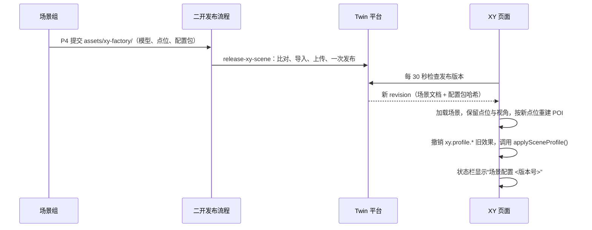

# XY 工厂 · 场景交付与配置包约定（v1.0 草案）

> 适用：XY 工厂案例 `xy-factory`。场景组维护模型场景本身：模型（含动画）、点位，以及**画面与性能**代码（材质、补光、性能优化等）。场景组只负责**构建、打包、维护版本号**，然后提交到 P4；导入平台、发布、页面接入全部由二开完成。二开只消费，不改写场景组的内容。本文是双方唯一的接口约定，修改需双方确认并升版本号。
>
> 起草：二开 · 2026-11-20 · 待场景组确认
>
> **发给场景组的版本**是构建工具包内的《XY工厂-场景交付约定与构建工具使用说明.md》（`threejs-twin-research/xy-scene-builder`，打包为 `xy-scene-builder-v1.0.zip`）。那份文档只保留场景组需要的约定和操作；本文另含二开内部的发布流程与页面接入。修改约定时两份需同步更新。

## 1. 原则

1. **同一份文件**：场景组提交到 P4 的产物原样进入平台。模型按原件 sha256 登记；配置包由平台按入口文件 sha256 校验，并随场景发布版本冻结。页面运行的就是场景组构建的那一份，二开不改代码、不重新构建。
2. **一条流程**：模型（含动画）、点位、配置包放在同一个交付目录，由二开一条命令 `release-xy-scene` 统一导入发布。只有发生变化的项会被处理，未变化时不会发布。
3. **自动生效**：发布后，页面在 30 秒内自动切到新版本，并重新应用配置包，无需重新部署前端。
4. **互不干扰**：配置包只改“模型长什么样、跑得多快”，不碰业务交互。边界见第 5 节，越界的需求先找二开扩展接口，不在包里绕过。

## 2. 分工

| 事项 | 场景组 | 二开 |
|---|---|---|
| 模型（动画内嵌在 GLB 中）、贴图、点位原件 | 导出，提交到 P4 `assets/xy-factory/` | 运行 `release-xy-scene` 导入并发布 |
| 材质、补光、阴影、LOD 等画面与性能代码 | 编写、构建 `dist/`、**维护版本号**，提交到 P4 | 运行 `release-xy-scene` 上传、绑定并发布；不改代码 |
| 平台账号、导入、发布、回滚 | **不涉及** | 负责 |
| 渲染内核（渲染器、相机、渲染循环、模型加载） | 不写，由 Twin SDK 提供 | 维护 SDK |
| 点选、描边、POI、楼层、运镜、动画播放、场景环境面板 | 不改 | 编写 |
| 场景配置包的调用 | — | 加载和换版时自动调用 `applySceneProfile` |

## 3. 交付目录

全部放在 P4 的 `assets/xy-factory/`。路径固定；更新时覆盖同名文件，不新增 `_v2` 一类的副本。

```text
assets/xy-factory/
├── models/
│   ├── L_Building.glb               园区外围
│   ├── L_Building2.glb              生产楼、库区楼
│   ├── L_Prop.glb                   库区道具（含 SQ_3 动画，Float32）
│   └── L_BP.glb                     点位：建筑标签与摄像头位置（空节点）
└── scene-packages/
    └── xy-scene-profile/
        └── dist/                    场景配置包构建产物：index.js + manifest.json
```

| 内容 | 二开流程如何处理 | 场景组需要保证 |
|---|---|---|
| `models/*.glb` | 按文件 sha256 判断是否变化；变化时检查动画精度、解压 Meshopt、校验、导入平台，替换场景实体引用的资产 | 坐标基准不变；业务节点（附录 A）不改名；**动画保持 Float32**，网格和贴图可以压缩，动画通道不要加 Meshopt 量化滤波，否则发布会被拦下 |
| `models/L_BP.glb` | 提取点位写入场景，页面按发布版本读取 | 每个点是一个有名称的空节点；建筑用楼名，摄像头名以数字结尾 |
| `scene-packages/xy-scene-profile/dist/` | 校验约定与 sha256 后上传；**只在版本号升高时发布** | 每次改动都提升 `version` 并重新构建 |

某个文件暂时没有提交时，场景继续使用已发布的版本，不会被删除。

## 4. 配置包规格

| 项 | 约定 |
|---|---|
| 格式 | 平台 customApi 包：`dist/index.js`（单个 ES 模块）+ `dist/manifest.json`（`schema: "twin-custom-api-package/1"`，含入口 sha256） |
| `packageId` | 固定为 `xy-scene-profile` |
| `contract` | `{ "id": "xy-scene-profile", "version": "1.0" }`，即本文版本 |
| 包 `version` | semver，**每次改动必须提升**（如 `1.0.0` → `1.0.1`）；版本号没升高的包不会发布 |
| three.js | **不得打进包内**，由宿主注入（构建工具 `xy-scene-builder` 已自动处理）；当前平台 three 版本 0.180 |
| 体积 | 建议 ≤ 2 MB；超过时先与二开确认首屏影响 |

### 包必须且只需导出两个函数

| 函数 | 函数 version | 参数 | 返回 | 要求 |
|---|---|---|---|---|
| `applySceneProfile` | 1 | 无（如需可选参数，必须有默认值，二开始终无参调用） | `{ applied: string[], missing: string[] }`：已生效的项目、未找到的节点 | **幂等**：重复调用结果一致；先撤销本包已有效果再应用 |
| `resetSceneProfile` | 1 | 无 | `{ reset: string[] }` | 撤销本包全部效果，场景恢复到未应用前 |

- 函数名和参数、返回结构属于本约定，变更需双方确认，并把函数 `version` 提升为 2。
- 只改内部实现时，**函数 version 保持 1，只提升包 version**。平台按包哈希绑定，二开侧无感知。
- 包内可以有其他辅助函数，但二开只调用上面两个。

## 5. 可以做 / 不能做

### 可以做（场景组自主决定，无需通知二开）

| 类别 | 内容 |
|---|---|
| 材质 | PBR 参数（金属度、粗糙度、`envMapIntensity` 等）、贴图采样（各向异性、mipmap）、透明与双面设置、按名称替换为新材质 |
| 补光 | **新增**自有灯光（补光、点光、聚光）及其阴影参数 |
| 阴影 | 模型网格的 `castShadow` / `receiveShadow`，修改后调用 `host.updateShadows()` |
| 性能 | 非业务节点的 LOD、按距离显隐或换低模、视锥剔除、合并非业务静态网格、降低自有灯光的阴影分辨率 |
| 逐帧效果 | 通过 `host.onFrame` 实现的不涉及相机的效果，如材质 UV 流动、闪烁灯 |

### 不能做（属于二开或平台，越界会直接影响业务）

| 禁止项 | 原因 / 替代 |
|---|---|
| 新建 `WebGLRenderer`、调用 `setAnimationLoop` / `requestAnimationFrame` | 平台上传时会直接拒收；逐帧逻辑用 `host.onFrame` |
| `host.acquireCamera`、修改相机位置、FOV 或相机控制 | 运镜、漫游、聚焦由二开控制 |
| `host.setRenderOverride`（接管最终绘制，如 EffectComposer） | 会让平台的选中描边失效。需要后处理时向二开提需求，由 SDK 提供可叠加接口 |
| 改动 `host.defaultLights`、`renderer.toneMapping`、`toneMappingExposure`、背景、雾、像素比 | 由 SDK 的场景环境（时间、天气、恢复默认）管理，业务面板会覆盖你的修改 |
| 调用 `viewer.environment.*`、`viewer.animations.*`、`viewer.camera.*`、`viewer.selection.*`、`viewer.hierarchy.setNodeVisible` | 这些是业务接口 |
| 修改**业务节点**的可见性、位置、旋转、缩放、父子关系或名称（见附录 A） | 楼层显隐、点位定位、动画轨道依赖它们；**材质可以改** |
| 操作页面 DOM、生成 UI、发起网络请求 | 包只作用于三维场景；需要外部数据时由二开传参 |
| 修改模型原件或平台资产 | 模型走 P4 → 二开发布流程 |

## 6. 编写规范

1. **所有效果必须登记在 `host.state`，且 key 以 `xy.profile.` 开头**，`dispose` 必须完整还原，例如 `host.state('xy.profile.materials', () => ({ dispose }))`。
   - 二开在换版时会按这个前缀统一撤销旧版效果，再调用新版的 `applySceneProfile`。
   - 不登记的修改无法撤销，换版后会残留叠加。
2. **幂等**：`applySceneProfile` 先撤销所有 `xy.profile.*` 状态再重新应用。不要沿用旧状态：`host.state` 在 key 已存在时会返回旧对象。
3. **容错**：找不到节点时记入 `missing` 后继续，**不要抛错**。某一项失败时 `log` 记录后跳过，保证其余项生效。只有包本身无法运行时才抛 `TwinError`。
4. **快**：`applySceneProfile` 应在 1 秒内同步完成。耗时任务（如生成 LOD）放到 `host.onFrame` 里分帧处理，并登记 `dispose`。
5. **共享材质**：同一材质可能被多个网格共用，用 `Set` 去重后再修改；只想改其中一部分网格时，先 `clone()` 再赋值，并在 `dispose` 中还原、释放。
6. **找节点**：用 `host.findNodes(名称或正则)` 和 `host.getObject({ entityId, nodeKey })`；遍历网格用 `host.getMeshes()`。节点名以 GLB 导出名为准。
7. **实体**：XY 场景当前包含 `xy-campus-exterior`（园区外围，L_Building）、`xy-campus-core`（生产楼与库区楼，L_Building2）、`xy-prop-sq3`（库区道具与动画，L_Prop），以及点位分组 `xy-anchors`（L_BP，无网格）。新增实体由二开导入后告知。

## 7. 从 XY-req 迁移

XY-req 的 `src/` 自带渲染内核，不能直接放进平台运行。按下表把可复用的部分改写成配置包里的“步骤”：

| XY-req | 配置包中的做法 |
|---|---|
| `src/engine/*`（渲染器、相机、渲染循环、`loadGlb`） | 删除，由 SDK 提供 |
| `src/lighting/<id>`：`apply(scene)` 返回清理函数 | 拆成两部分：新增灯光登记到 `host.state('xy.profile.lighting', …)`；对默认太阳光、天空、背景的改动**不迁移**（见第 5 节） |
| `src/features/<id>`：`install({ addPass })`、`onSelection` | 不涉及选中和后处理的逐帧效果改用 `host.onFrame`；描边、选中效果属于二开，不迁移 |
| `src/models/<id>`：材质调整、`nodeAt([...])` 节点映射 | 材质调整迁入，用 `host.findNodes` 定位；业务部件 ID（`partId`）映射由二开维护，不迁移 |
| `src/contracts`、`src/app`、`src/ui` | 工作台专用，不迁移 |

场景组仍可保留 XY-req 作为离线调参工作台，确定效果后再写进配置包。最终效果以 XY 页面为准；两边渲染设置不同，见第 12 节第 4 项。

## 8. 示例

构建工具自带两个示例（`src/steps/example-*.js`）：修改已有材质、新增补光。每个效果一个文件，入口 `src/index.js` 和 `src/manifest.js` 已按本约定写好，场景组一般只需要在 `src/steps/` 里新增文件。约定包内容等价于：

- `applySceneProfile`：先撤销全部 `xy.profile.*`，再依次执行各个效果。单个效果失败只记日志，返回 `{ applied, missing }`。
- `resetSceneProfile`：撤销全部 `xy.profile.*`，返回 `{ reset }`。
## 9. 场景组：构建与提交

使用构建工具 `threejs-twin-research/xy-scene-builder`（使用说明见其 README）。工具内置了本约定：包名、约定版本、两个函数、禁止事项、模型和点位检查，预览的渲染设置也与平台一致。

```powershell
npm run preview          # 本地预览：交付目录中的模型 + 配置包，保存即刷新
npm run version:patch    # 提升版本号
npm run deliver          # 构建并检查，复制到 scene-packages/xy-scene-profile/dist/，打印变更单描述
```

然后在 P4V 中提交 `assets/xy-factory/`。平台账号、上传、绑定、发布、回滚，都不需要场景组操作。
## 10. 二开：统一发布流程

二开从 P4 同步 `assets/xy-factory/` 后，运行一条命令：

```powershell
$env:XY_PLATFORM_USER = '<账号>'; $env:XY_PLATFORM_PASSWORD = '<密码>'
node scripts/release-xy-scene.cjs <P4 本地目录>\assets\xy-factory <平台 API 地址> [--dry-run]
```

脚本是 [release-xy-scene.cjs](../scripts/release-xy-scene.cjs)，实体与资产的对应关系在 [xy-release.config.json](../scripts/xy-release.config.json) 中配置。流程：

1. **比对**：计算每个模型、点位文件和配置包的 sha256，与场景草稿中登记的指纹比较，只处理有变化的项。`--dry-run` 只列出待发布项，不做改动。
2. **模型**：先检查动画精度，动画被量化（整数或 Meshopt 滤波）时停止发布并给出原因；再解压 Meshopt、校验 glTF、导入平台，并更新实体引用的资产版本和指纹。
3. **点位**：从 `L_BP.glb` 计算每个点的世界坐标，写入分组实体 `xy-anchors`。页面优先读取这份数据，读不到时使用代码自带的快照。
4. **配置包**：先检查约定（`packageId`、`contract`、两个函数及其 version、sha256），版本号必须高于已发布版本，然后上传并绑定到案例。版本号升高但代码与已发布的完全相同时，跳过发布。
5. **发布**：所有改动合成**一次**发布。全部内容都没有变化时不发布。

平台上传时会拒收以下问题：sha256 不一致、带有未打包的模块依赖、未导出 `functions`、自建渲染器或渲染循环。同一函数 id 和版本已被**其他包**占用时，上传也会被拒绝。以下情况只给出警告、不拒收，但同样不允许：疑似打包了独立的 three、使用 `requestAnimationFrame`、操作页面 DOM。

**回滚**：在 P4 中把文件回退到上一个版本后重新运行脚本。配置包回退时，版本号仍须高于当前已发布版本（例如 `1.0.3` 的内容以 `1.0.4` 重新提交）。紧急情况下，管理员也可以在平台上把发布指针切回上一个 revision。

## 11. 页面如何消费（供场景组了解）



- 首次进入页面、场景换版、点击“重试”后都会执行上述流程。
- 新版本里没有 `applySceneProfile` 时，只撤销旧效果，场景以原始状态显示。
- `applySceneProfile` 抛错只记日志，状态栏显示“未生效”，不影响业务功能。

## 12. 变更规则与待落实

| 变更 | 是否需要通知二开 |
|---|---|
| 第 5 节允许范围内的任何调整 | 不需要，提升版本号后提交 P4 即可 |
| 模型、点位按原路径更新 | 不需要，P4 变更单写明内容即可 |
| 函数名、参数、返回结构 | 需要，双方确认后提升函数 version 和本文版本 |
| 需要第 5 节禁止的能力（后处理、相机、环境、业务节点） | 需要，二开先在 SDK 或页面提供接口 |
| 模型节点改名、增删业务节点，新增模型文件 | 需要（变更单附新旧映射；新增模型由二开在发布配置中登记实体） |

| # | 待落实事项 | 负责 |
|---|---|---|
| 1 | 场景组确认本文，指定首版配置包负责人 | 场景组 |
| 2 | 场景组把动画为 Float32 的 `L_Prop.glb` 按第 3 节目录提交到 P4（目前只在研究目录） | 场景组 |
| 3 | P4 同步后由谁运行发布命令、频率如何（按变更单通知或定时） | 二开 |
| 4 | 给 XY-req 工作台增加平台渲染参数预设（ACES 色调映射、曝光 1.15、sRGB），减少离线调参与线上的画面差异 | 双方 |
| 5 | SDK 提供可与选中描边叠加的后处理接口（有需求时） | 二开 |
## 附录 A：业务节点（禁止修改可见性和变换，材质可改）

| 实体 | 节点 | 业务用途 |
|---|---|---|
| `xy-campus-core` | `生产楼`、`库区楼`，以及名称含 `_生产楼_`、`_库区楼_` 的节点（如 `…_库区楼_2F`、`…_生产楼_副楼`） | 楼栋点选、楼层显隐 |
| `xy-prop-sq3` | `SM_LK_TSJ` 及其子节点 `SM_LK_TSJ_2`、`SM_LK_TSJ_1`；`一级`～`四级`、`转运机1`、`转运机2`、`托盘_SQ3b`、`货3b`、`托盘_SQ3b2`、`货3b2`、`CineCameraActor_SQ3_1`、`CineCameraActor_SQ3_2` 及其子节点 | SQ_3 动画轨道与运镜 |
| `L_BP.glb`（点位文件） | 全部空节点及其名称（7 个楼名、`园区监控摄像头1`～`13`） | 目录、POI、楼栋定位；改名会导致目录项变化 |
| 全部 | 所有实体的根节点 | 平台定位与显隐 |

本表随业务扩展更新，以本文最新版本为准。
