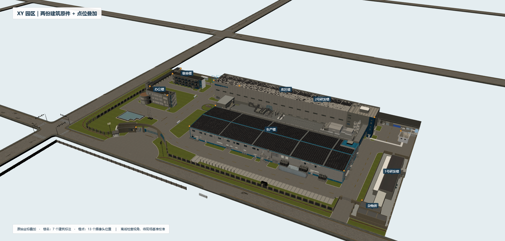

# XY工厂演示demo｜首批交付包评估与接入方案

2026-11-20 · 接收目录：`threejs-twin-research/XY-req` · 交付应用：`dengta-twinProject`。本文补充[原项目制作方案](XY工厂演示demo-项目制作执行方案.md)，回答这批实物能做什么、由谁补什么、怎样接到现有工程。

**决策：接收为“园区静态资产与点位”首批素材。** 已有可辨识的 XY 园区，适合先做“园区总览 → 生产楼/库区楼 → 楼层显隐 → 摄像头点位”的演示。两份模型在本机可同屏渲染；当前本地 Twin 平台的导入检查不接受原件。建筑先出兼容小样，点位独立转成 XY 数据，面板同步用演示数据开发。动画、视频和设备业务各自验收，不让它们阻塞静态园区，也不把它们算作已交付。

图为本机 Chrome 在临时 Three.js 检查页中直接读原件生成。保留两份模型变换，未按文件分别居中；楼名与橙点取自 `L_BP.glb`。给场景同事核对相对位置使用。镜头、灯光及标签样式是检查页设置；该图不能证明工作台已集成、现场坐标已校准或平台已发布。

## 1. 收到的东西

目录共 50 个文件，115,509,446 字节。主要内容是一个独立的 Vue 3 / Three.js 美术工作台及其构建产物、三份 GLB、开发约定与工作台自测。资产目录说明仍写着没有正式模型；二进制实物与这句说明不一致，正式场景目录则确实没有登记这三份模型。

| 实物 | 打开后能确认什么 | 接到 XY 时怎样用 |
|---|---|---|
| `assets/models/L_Building.glb`（69.18 MiB） | 1 场景，67 个根节点、67 个 mesh、255 组绘制图元、176 个材质、258 张 WebP。包含园区围墙道路、研发楼、办公楼/宿舍墙体与玻璃、配电房/保安亭、冷凝器等命名构件。 | 园区底景及外围建筑。视觉上是与第二份组合使用的素材；楼名不构成设备台账。 |
| `assets/models/L_Building2.glb`（40.21 MiB） | 1 场景，5 个根、96 个节点（其中 8 个未命名）、86 个 mesh、303 组图元、89 个材质、99 张 WebP。可辨识生产楼、库区楼、货架、路灯；有库区 1F–4F 及屋顶、生产楼 1F–3F 及副楼相关节点，也有光伏、消防等命名线索。 | 生产楼、库区楼和分层交互的优先素材。不要把它当作第一份的升级替换件。每层能独立隐藏到什么粒度，要看转换后节点和实画。 |
| `assets/models/L_BP.glb`（1,780 字节） | UE 5.5.4 导出，20 个有名称和位移的根空节点，无网格、缓冲、朝向、glTF 相机或动画。13 个“园区监控摄像头1…13”；另有生产楼、库区楼、1/2号研发楼、杂物房、办公楼、宿舍楼。 | 作为标签/监控点坐标；[20 点原始坐标清单](xy-first-delivery/anchors.raw.json)保留原名、索引、原始精度及源文件 hash。业务 ID 暂空。不要作为第三件可见模型导入，或把名字里的 BP 当作可执行蓝图。 |
| `src/`、`dist/`、`package*.json` | `webgl-xybk@0.1.0`，Vue 3.5.45、Three 0.187.0、Vite 8.3.8，Node ≥22.18。正式 `catalog.ts` 只组装运输箱、信标塔、基准灯光和描边；预览按 `src/models/*/index.ts` 发现模型模块，松散 GLB 不会自动进入预览。`dist` 是该网页的 HTML/CSS/JS。 | 供场景侧检查材质、模型选择/显隐、灯光及版本对照。正式交付端保持 Vue 2 + Twin SDK；不搬运 `dist`，不嵌入另一个 renderer。 |
| `docs/`、`tests/`、`scripts/` | 工作台分工、开发规范、设计与测试。现有 GLB 测试用内存样例验证节点路径，不覆盖这三份园区原件。 | 可借鉴场景侧的验收工作流和稳定命名约定，不能代替资产验收或业务接口合同。 |

三份文件均无外链资源、动画片段、蒙皮或 glTF 摄像机，也没有 `extras.twinNodeId`。包里没有平台 `scene.json`、资产锁、资产 manifest、XY 专属 API 包、发布记录/交付码、业务接口样例、视频源或书签。未见可运行的 XY 产线运动实现。工作台提供逐帧回调入口，但当前命令只有选择、显隐和镜头复位；GLB 加载合同仅返回 `root` 和 `targets`。

## 2. 为什么原件能看，却不能直接发布

我们对同一批原件做了三种不同检查：读取 GLB 的实际结构，用本机浏览器渲染，然后用当前工作区平台的 `inspectGlb`（普通模型自动导入模式）及 Khronos `gltf-validator` 离线校验。没有向目标平台上传文件，没有创建或发布案例。

| 检查 | 结果 | 对接入的影响 |
|---|---|---|
| 浏览器组合预览 | 本机 Three 0.180.0 的 `GLTFLoader` 显式注册 `MeshoptDecoder` 后，按原位加载两份 GLB，并投影 20 个标签/点。见上图。 | 证明原件有可读的几何、材质和相对布局；这个解码条件与平台 runtime 不同。不能据此签收性能或最终画面。 |
| 平台自动资产检查：两份建筑 | 均返回 `E_UNSUPPORTED_ASSET: Invalid glTF structure: Array must contain at most 1 element(s)`。两者各有两个 `buffers` 条目，第二个是 Meshopt 的虚拟回退缓冲；平台检查最多允许一个。两者还都必需 `EXT_meshopt_compression`、`KHR_mesh_quantization`。当前平台允许后者，未启用前者；DSL 检查同样限制必需扩展，runtime 的 `GLTFLoader` 未注册 Meshopt 解码器。 | 当下第一道失败来自缓冲结构，不是超出上传大小，也不是少交了外部 `.bin`。只改白名单、改扩展名或补一个 `scene.json` 都不能打通整条链。 |
| 独立 glTF 标准检查：两份建筑 | 分别为 516 错/258 警告、198 错/99 警告。错误集中在 `IMAGE_NON_ENABLED_MIME_TYPE` 和 `TEXTURE_INVALID_IMAGE_MIME_TYPE`：357 张 WebP 被作为普通 `texture.source` 引用，未按 `EXT_texture_webp` 声明和绑定。 | 这是与 Meshopt 独立的问题。平台有 WebP 扩展支持；请正确导出扩展或转为 PNG/JPEG（有透明通道的材质保留透明），再按参考画面对照玻璃、地面、屋顶。 |
| 两种检查：`L_BP.glb` | 标准检查 0 错/0 警告；平台模型入口返回 `E_UNSUPPORTED_ASSET: Active scene has no mesh geometry`。 | 点集作为 glTF 是合法的，不能作为有几何的资产入库。直接采用点位清单，经校准后用 SDK 创建 POI；无需塞占位网格来过检查。 |

**坐标与粒度。** glTF 按本地米制、Y 向上、右手系解释；现场实尺和原点仍待确认。生产楼与库区楼的模型根变换都接近 `[28.717, 13.505, -15.64]`，两个楼名标签却分别在 `[36.767, 25.314, 3.645]`、`[23.067, 31.614, -48.855]`。标签是讲解位置，不能拿来重新摆放建筑。请场景侧给三个不共线的共同基准点、至少一段已知长度及俯视参考图；两个模型与所有 POI 一起应用同一变换。视角另存 `position + target`，不从点位猜摄像方向。

**性能。** 按独立 mesh 的图元索引统计，两份建筑各约 314 万、356 万个三角形，合计 671 万；含 23 + 2 个 GPU 实例化节点，按实例数展开约 927 万。原件合计约 109.39 MiB。这些是资产规模，不是帧率。当前浏览视角还会画到园区外的道路；应以园区讲解范围设首屏镜头，别对整份道路包自动取景。目标机上再决定是否按区/楼层拆包、裁未讲解外围、做材质或细节级别优化；合批前保护要拾取的楼层和设备。

## 3. 灯塔功能怎么复用

复用的是通用 UI、交互和标准 SDK 能力。XY 自己持有楼栋/楼层/设备目录、场景映射、书签、数据源和专属动作。下表区分“有素材可做”“缺什么才可验收”，不将演示数据当作园区事实。

| XY 需求 | 本包覆盖 | 执行与验收边界 |
|---|---|---|
| 园区总览、漫游、复位、测距/测面、环境与时间 | **有几何**，无交付镜头、行走边界及实尺。 | 复用 viewer 相机、测量与环境控件；制作 XY 全景/生产楼/库区书签，按已知长度验测量，检查第一人称出生点、地坪和玻璃/阴影效果。 |
| 建筑目录、点选、楼层显隐、透视 | **有建筑点和分层候选**。部分外围模型已按材质或构件合并；未确认全园区都可逐楼逐层控制。 | 优先验生产楼和库区楼。一层映射一组可见节点，列表点楼/层能定位，点模型能回到同一目录项，复位恢复全景。地下管网/环网须有相应几何与语义再启用。 |
| 摄像头与巡检 | **有 13 个位置**；无通道、URL、在线状态、镜头朝向或巡检路线。 | 首期给可筛选的摄像头 POI，点击显示名称及位置；未接流显示“未接入视频”。巡检由 XY 书签、站序、讲解词驱动；真视频另接通道 ID、授权取流及异常状态。 |
| 设备目录、详情/健康、部件拆解 | **只有构件线索**；无业务台账、测点、健康算法、独立设备与拆解参数确认。 | 复用目录、趋势、详情交互；先让一台代表设备贯通 `businessId → entityId/nodeKey → 部件`。设备爆炸要验部件、支点及偏移，未提供的动作不展示。 |
| 告警、处置、历史趋势、AI 助手 | **无业务数据或服务合同**。可并行制作列表、详情、筛选、对话和空态。 | XY DataProvider 驱动，只用明示的演示样例。接实时前需给一条含时间/级别/设备 ID 的告警、一条处置结果及一段历史；AI 只允许当前案例已实现的查询/定位/处置动作。不得回调灯塔模拟器。 |
| 仓储、库存、布局 | **有库区楼和货架外形**，无货位 ID、库存、占用或可编辑对象规则。 | 可以先做仓库定位。库存配色需“货位 ↔ 节点/实例 ↔ SKU/数量/时间”；非产线布局编辑需可移动对象与保存接口。原灯塔作业/物流脚本不迁入。 |
| 能耗、安全应急、辐射、热仿真 | **有光伏、消防等命名线索**；无计量读数、应急路线、剂量场或 XY 工程仿真数据。 | 可先设计能源/安全面板。按计量/消防台账落图；疏散线须由业务方确认出口和可走路径。辐射与 VTK 只在交付 XY 对应数据、单位和配准后启用。 |
| 运动动画、生产仿真与溯源 | **三份原件均为 0 个 clip；未交 XY 运动脚本。** | 场景预置运动按 XY 专属能力另验，详见下节。灯塔自动跑线、产品全流程跟随、生产溯源及其历史产线回放不迁移；设备非产线历史仍按 XY 设备与告警数据合同独立接入。 |

## 4. 接入路线：优先让一个真实楼层从平台发布出来

1. **场景侧出兼容变体，原件封存。** 优先从生产楼或库区楼取一层，保留其在园区的原始变换、材质和可点选的层级，另给一个对应楼名点、一个摄像头点和参考图。输出自包含单缓冲 GLB、dense accessors，无必需 Meshopt；修复 WebP 引用或转码。验证实例化物件的位置/数量；如需逐实例绑定业务，应提供可验证的实例映射或拆出相应对象。记录原件与变体的版本/hash、导出设置和节点别名。
2. **平台侧先走已有“模型资产导入”通道。** 固定目标平台/runtime 版本，在隔离的 XY 草稿通过编辑器资产库 `client.importModel` 上传小样；等任务成功、记录资产报告，再将资产摆入场景，配置 XY 书签、节点映射，发布到 **XY 独立交付码**。用现有 `createTwinApp` 加载这个发布版，验材质、位置、点选、显隐；小样通过再导两份全量建筑。自动生成的 `node-索引` 只对当前资产版本有效，不能当永久业务 ID。
3. **点位走数据通道。** 从附件点表取原始位置，与两个模型一起校准。XY 维护 `anchorId ↔ businessId（如有）↔ 楼栋/楼层/视频通道（如有）`。独立保存场景发布 revision、点位数据 revision 和变换。场景 ready 后由 XY 适配层创建 POI，离场清理。验收时清点 7+13 个点，对照参考图逐一点选，摄像头缺流只显示位置。
4. **若最终要求整包交接，再落 DSL。** 以目标实际接受的版本为准。本地 `0.1.0-draft` 链路需要 `scene.json` 的 `assetLockRef`、匹配 revision 的锁文件、逐资产 manifest、文件/hash、可映射的节点 ID、实体与视角；用 `readDslBundle` 看诊断，`importDslBundle` 在 XY 草稿验证。场景侧可维持自有创作协议，由版本化转换器生成平台包和映射报告；未知必需扩展/动作阻断发布，可选字段记录降级。不要让业务组件判断 DSL 版本。
5. **只有原始压缩必须保留时，才单列平台改造。** 平台方评估服务端结构/解码与资源边界、DSL 必需扩展检查、runtime 解码器及版本发布；分别验证原件、兼容变体和灯塔旧资产，保留旧版回滚。WebP 引用错误仍须修复。无论选哪条路线，交付端不旁路读 GLB，不切换到另一个场景引擎。

**运动怎样验。** 先约定由谁驱动。① 若是 GLB 内的烘焙片段，场景侧给一个实际在动的对象、`clipName`、时长、初态、循环/停止语义；普通模型自动导入会提取片段，必须再在发布版以 `scene.getClipNames(entityId)` 查到并实际播放、停止、重入。当前 DSL 路径 `dslAssetMetadata()` 输出 `clips: []`，带动画资产可能在导入时报元数据不匹配；采用这条路线前须验证并按需修 importer。② 若是场景脚本或编排，交 XY 专属 custom API 包、函数签名、版本、作用对象、完成/异常通知和停止/销毁约定，参考平台现有 `customapi-template` 的 manifest 与脚本打包形式。由 `SceneAdapter` 探测并调用；若设计成自动循环，验初始化只启动一次及离场清理。两条路线都不能用灯塔的 `startProduction` 顶替；未收到可运行样例前不显示播放按钮。

## 5. 交付端和面板可以怎样并行

- **场景资产交付**：`D:\P4_workspace\WebGL\51CD_2026\WebGL_EC9_Demo\assets\xy-factory` 是场景同事持续更新的交付目录。P4V 提交范围是 XY 场景原件和随包交接材料：模型、贴图、点位，以及后续由场景侧提供的动画、坐标、层级映射和场景清单。`E:\All_in_wdp\wdpapi_sdk\dengta-twinProject` 仍是二开开发和验证工作区，二开代码及构建产物不进该交付目录；平台使用的转换副本由导入流程生成。
- **工程接入：** 仍用 `dengta-twinProject`。顶部应用级案例菜单增加“XY工厂”，指向独立 `/xy-factory`；灯塔默认 `#/page_2/2`、交付码及导航保持原值。`src/layout/scene.vue` 继续是唯一宿主，按路由案例选择配置，切换时取消旧加载、解绑订阅、清 POI/动画、释放旧实例，再加载新交付码。XY 配置缺失显示本案例未配置，不能误落到灯塔场景。当前灯塔页初始化会调用 `getCatalog`、`startProduction`，巡检与疏散路线也写有灯塔坐标，不能把整页挂到新路由。
- **业务面板：** `src/views/xy_factory/` 内用 `api/` 管设备、告警、计量/仓储等 DTO，`scene/` 管 `聚焦 / 高亮 / 显隐 / 打点 / 运动`，`components/` 只收业务数据与操作。模型映射保留 `case/revision、businessId、model/entity、nodeKey 或 anchorId`；同一业务对象可对应多个渲染节点。未映射时显示“暂无空间定位”，不取灯塔坐标兜底。共享告警列表、趋势图、处置表单等 UI 时，以传入的数据和事件为界。
- **首版面板顺序：** 首页只展示可核实的园区目录、点位数量和入口；左侧楼栋/楼层/摄像头目录，右侧选中项详情与可用动作。场景方供模期间，前端可用 7 栋建筑、13 个摄像头的真实名称做目录，业务数据模块可用标明“演示”的独立样例。无流、无台账、无动画分别有空态，不绘制虚构的在线率、告警数或能耗曲线冒充实况。

| 交付节点 | 主责 / 可并行工作 | 通过条件 |
|---|---|---|
| A：下一份最小交付 | 场景侧：1 个兼容楼层、楼点+摄像头点、基准点/已知尺寸、场景参考图及别名清单。平台侧同时确认目标版本、XY 草稿与发布权限。前端同时制作目录/空态。 | 小样通过标准及平台检查；已知距离、节点和点位在同一坐标系可复核。 |
| B：首个静态演示 | 平台/前端：小样发布后接入完整两份建筑、楼层和全部点位，走“全景 → 楼 → 层 → 摄像头 → 复位”。补齐首页书签、开关和错误态。 | 发布版 SDK 可直达；列表与拾取互通；全量 20 点核对；无流可演示位置。首屏和近景与场景方参考图相符。 |
| C：按能力逐项点亮 | 场景侧另交 1 个真实运动小样及控制合同。业务侧另交 1 台代表设备、1 条告警及处置结果；视频、能耗、仓储按各自数据到位时间接入。 | 每项分别跑通数据 → 面板 → 场景 → 清理/错误态，真数据与演示样例可区分；未满足的项不标验收通过。 |
| D：现场交付与回滚 | 平台/前端/现场在目标浏览器、GPU、分辨率下记录冷加载、稳定视角和巡检的 p95 帧时、显存或资源计数；与业主先约定门槛。保存 XY revision、资产 hash、映射和可回退发布版。 | 验 XY 直达/刷新、断包重试及“灯塔 → XY → 灯塔”反复切换；旧监听/覆盖物不残留、显存不持续增长；灯塔默认场景、设备、告警及产线行为保持基线。回滚只动 XY。 |

## 核查依据与复核入口

- **原件指纹（SHA-256）**：`L_Building.glb` = `42c5dc530c11ca9045937ad5506766de92f62511b18a0fd2b54d257040bd3757`；`L_Building2.glb` = `3165f0b3728f9d361a5b2e1611595f3278c591a542b80bd34752704eff4fb756`；`L_BP.glb` = `346f86c1234f478d3a11e7f1b2b42e3b8072316f98d6e4e61e42d662e5d14db5`。后续兼容版另列指纹，不覆盖原件。
- **场景侧**：[正式目录](../../threejs-twin-research/XY-req/src/app/catalog.ts)、[预览目录](../../threejs-twin-research/XY-req/src/app/previewCatalog.ts)、[GLB 加载器](../../threejs-twin-research/XY-req/src/engine/loadGlb.ts)、[交互合同](../../threejs-twin-research/XY-req/src/contracts/scene.ts)。
- **平台侧**：[资产入口](../../threejs-twin-p0/apps/editor/src/AssetLibrary.vue)、[资产检查与动画元数据](../../threejs-twin-p0/services/platform/src/asset-inspect.ts)、[DSL 检查和导入](../../threejs-twin-p0/packages/sdk/src/dsl.ts)、[runtime 加载器](../../threejs-twin-p0/packages/runtime/src/assets.ts)、[专属 API 包范例](../../threejs-twin-research/customapi-template/README.md)。
- **交付端**：[应用壳](../src/views/index.vue)、[场景宿主](../src/layout/scene.vue)、[路由](../src/router/index.js)、[灯塔页面与专属调用](../src/views/page_2/page_2_2/index.vue)。本轮仅做本地实物检查、组合预览与方案交付；未修改原包、现有页面或交付配置，未运行目标平台发布和现场性能验收。
